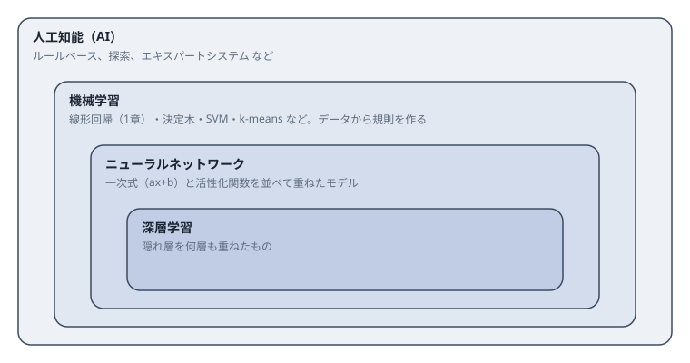
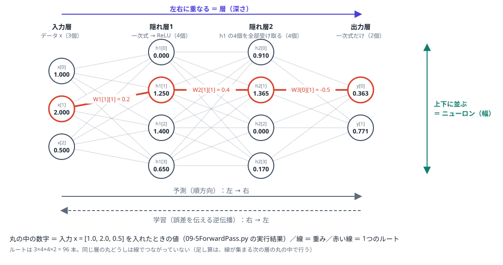

# ９．ニューラルネットワーク

ここまで機械学習を構成する要素（予測・損失・勾配・補正、行列演算、文字のデータ化、次元削減など）について説明してきたが、
本章ではニューラルネットワークという、それらを組み合わせた複合的、総合的な解決手段について説明する。

## 9.1 ニューラルネットワークの位置づけ



- **人工知能（AI）**：知的な振る舞いをさせる技術の全体。人が書いたルールで動かす方法も含む。
- **機械学習**：データから規則（係数）を自動で決める方法の全体。1章の `y = a*x + b` も、決定木やSVMも、ここに入る。
- **ニューラルネットワーク**：機械学習の一手法で、**一次式（ax+b）と活性化関数を並べて、重ねたモデル**である。
- **深層学習**：隠れ層を何層も重ねたニューラルネットワーク。

ニューラルネットワークの特徴は、**モデルの式の形を人間が決めなくてよい**ことである。1章では `y = a*x + b` と形を決めて、
a と b だけを学習した。`y = x**2` のようにその形で表せない関数が相手なら、別の式を考え直す必要がある。
ニューラルネットワークは、同じ部品（一次式＋活性化関数）の数と並べ方を変えるだけで、直線にも曲線にも合わせられる。
その代わり、部品の係数が多くなる。

これまでの章で扱った要素は、ニューラルネットワークの中でそのまま使われる。

| 章 | 内容 | ニューラルネットワークでの位置づけ |
|---|---|---|
| [1.機械学習の基本](../1.MachineLearningBasic) | `y = ax + b` の予測→Loss→微分→補正 | NNの学習も同じサイクルを、係数の数だけ繰り返す |
| [2.学習プロセスの構成](../2.Configuration) | 損失関数、初期値、学習率、局所解 | NNではこれらの悩みがより深刻になる（9.8のスパイクもその一例） |
| [3.16×16ドット](../3.16x16Dots) | 256入力+バイアスで「1」を判定 | 1層のニューラルネットワーク（パーセプトロン） |
| [4.配列・Python・NumPy](../4.ArrayPythonNumPy) | 行列演算、numpyの実装方針 | ニューロンの計算を、まとめて速く行う方法 |
| [5.ベクトル・行列](../5.VectorMatrix) | 多クラスの線形層（入力ごとに重みをかけて足し、ずらしを足す） | 全結合層（ニューロンを並べた層）そのもの |
| [6.文字、Token処理](../6.Text) | 文字・トークン単位でのデータ化 | 自然言語処理やLLMの入力前処理 |
| [7.次元削減](../7.DimensionReduction)・[8.](../8.DimensionReduction256) | PCA、256次元の次元削減と量子化 | 中間層が学習する特徴表現、モデル圧縮に直結 |

## 9.2 ニューラルネットワークの絵の読み方



絵は、**処理の流れが左から右**、**同じ層の丸は上下に並ぶ**、という描き方が一般的である。この読み方で正しい。
読むときに押さえる点は次のとおりである。

1. **左→右は予測の向き**である。入力 x が左から入り、層を通って右の出力 y になる。学習で誤差を伝える向き（逆伝播）は、右→左になる。
2. **上下に並ぶ丸は、同じ層のニューロン**である。この数を**幅**と呼ぶ。**左右に重なる層の数**を**深さ**と呼ぶ。
3. **丸はニューロン（計算する部品）、線は係数（重み）**である。丸の中の値は入力ごとに変わるが、学習で変わるのは線にかかる数（と丸ごとのずらし b）である。
4. 絵では前の層の丸と次の層の丸が全部つながっている（**全結合**）。画像用のCNNなどは、一部だけをつなぐ。
5. 赤い線は、入力から出力までのルートを1つ選んだものである。この絵では 3×4×4×2 = 96 本ある。
6. 丸の中の数字は、9.5のコードに、入力 `x = [1.0, 2.0, 0.5]` を入れたときの値である。

絵の要素とコードの対応は次のとおりである。

| 絵の要素 | コード |
|---|---|
| 丸1個 | `z = a*x + b` を計算して、関数 `f` を通す |
| 線1本 | 重み `W[j][i]`（前の層の i 番目 → この層の j 番目にかける数） |
| 上下に並ぶ丸 | `for j in range(H):`（H がニューロン数＝幅） |
| 左右に重なる層 | 前の層の出力を、次の層の入力にする（層の数＝深さ） |
| 左→右の流れ | `predict`（予測）を計算すること |
| 右→左の流れ | 誤差から各係数の勾配を求めること（9.6の勾配の計算） |

## 9.3 構成要素：一次式と活性化関数

### 一次式

```
y = a·x + b
```

```python
def linear(x, a, b):
    return a * x + b
```

入力が複数あるときは、入力ごとに係数をかけて足す。

```
z = w₁·x₁ + w₂·x₂ + … + wₙ·xₙ + b
```

```python
z = b
for i in range(len(xs)):
    z = z + ws[i] * xs[i]
```

### 活性化関数

```
ReLU(z) = max(0, z)
```

```python
def relu(z):
    return max(0.0, z)      # 負なら0、正ならそのまま
```

グラフにすると、0 までは平らで、0 を超えたら傾き1で上がる折れ線（折れ目が1個）である。使われる関数は ReLU のほかにもある。

```python
import math

def relu(z):
    if z > 0:
        return z
    return 0.0

def leaky(z):
    if z > 0:
        return z
    return 0.1 * z

def tanh(z):
    return math.tanh(z)

def sigmoid(z):
    return 1 / (1 + math.exp(-z))

def linear(z):
    return z
```

| 関数 | -2 | -1 | 0 | 1 | 2 | 特徴と主な用途 |
|---|---:|---:|---:|---:|---:|---|
| relu | 0.00 | 0.00 | 0.00 | 1.00 | 2.00 | 折れ線。計算が単純で、隠れ層の標準 |
| leaky | -0.20 | -0.10 | 0.00 | 1.00 | 2.00 | 負側にわずかな傾き。動かなくなるニューロンの対策 |
| tanh | -0.96 | -0.76 | 0.00 | 0.76 | 0.96 | -1〜1 に収まる滑らかなS字。滑らかな関数の近似向き |
| sigmoid | 0.12 | 0.27 | 0.50 | 0.73 | 0.88 | 0〜1 に収まる。3章の判定（確率） |
| linear | -2.00 | -1.00 | 0.00 | 1.00 | 2.00 | 何もしない。回帰の出力層 |

複数の値をまとめて確率にする softmax もある（多クラスの判定、5章）。

```python
zs = [2.0, 1.0, 0.1]
total = 0.0
for z in zs:
    total = total + math.exp(z)
for z in zs:
    print(math.exp(z) / total)       # → 0.66, 0.24, 0.10（合計が1）
```

### ニューロン＝一次式＋活性化関数

```python
def neuron(x, w, b):
    z = linear(x, w, b)       # 一次式（係数 w, b を持つ）
    return relu(z)            # 活性化関数（係数を持たない）
```

ニューロンが持つ係数は **w と b だけ**で、活性化関数は学習中ずっと同じ形である。w と b を変えると、折れ線が次のように動く。

```python
neuron(x, 1, 0)     # x=0 で折れる。右上がり
neuron(x, 1, -1)    # x=1 で折れる（b を下げると折れ目が右へ）
neuron(x, -1, 0)    # x=0 で折れる。左上がり（w が負だと向きが反転）
neuron(x, 2, 0)     # x=0 で折れる。傾きが2倍
```

折れ目の位置は `-b / w` である。

### 出力層

回帰（数値を予測する課題）では、出力層は活性化関数を挟まず、一次式だけにする。

```python
y = c                          # c：全体の上下位置
for i in range(H):
    y = y + v[i] * h[i]        # h：隠れ層の出力、v：倍率
```

出力にも ReLU をかけると、出力が0以上に限られてしまうためである。判定なら sigmoid、多クラスなら softmax を出力層に使う。

## 9.4 なぜこの形か：特徴・合理性・背景

### 活性化関数がないと、層を重ねても直線のままである

```python
y = linear(linear(x, a1, b1), a2, b2)
# = a2 * (a1 * x + b1) + b2
# = (a2 * a1) * x + (a2 * b1 + b2)       ← 結局、傾きとずらしが1つずつの直線
```

曲がった関数を作るには、一次式と一次式の間に、曲げる部品（活性化関数）が必要である。

### 一次式を部品にする理由

- 係数が少なく（w と b）、動かしたときの結果の変化が単純で、勾配が簡単に求まる。
- 入力が多くても、「掛けて足す」の繰り返しにまとまり、まとめて高速に計算しやすい（4・5章）。
- 同じ形の部品を並べるだけなので、構成が機械的に作れる。

### ReLU が標準になった理由

```python
def relu_grad(z):
    if z > 0:
        return 1.0                 # 正の側では、傾きがいつも1
    return 0.0

def sigmoid_grad(z):
    s = sigmoid(z)
    return s * (1 - s)             # 最大でも 0.25（z=0のとき）

0.25 ** 5       # = 0.00098  ← sigmoid を5層重ねると、勾配が約千分の1に縮む
```

誤差を出力側から入力側へ伝えるとき、各層の傾きをかけていく（9.6）。sigmoid や tanh は傾きが1より小さいため、層が深くなると勾配が消え、
入力に近い層が学習できなくなった。ReLU は傾きが1で、計算も `max(0, z)` だけと単純なため、深い層でも学習しやすい。

### 層を重ねる意味

- 1層目のニューロンは、入力 `x` から折れ線を作る。
- 2層目のニューロンは、`x` ではなく、**1層目の出力を入力にして**、さらに折れ線を作る。折れ線を、もう一度加工する。

```python
# 1層目：入力は x
h1[j] = relu(W1[j] * x + b1[j])

# 2層目：入力は 1層目の出力 h1
z = b2[j]
for i in range(len(h1)):
    z = z + W2[j][i] * h1[i]
h2[j] = relu(z)
```

同じ形の計算を、前の層の出力に対して繰り返しているだけである。

重ねると、出力グラフの折れ目の数は増えやすい。`y = x**2` を実際に学習した結果は次のとおりである（1層あたり8個、9.5の実測）。

| 層の数 | 学習後の折れ目の数 |
|---:|---:|
| 1 | 7〜8 |
| 2 | 12〜18 |
| 3 | 15〜23 |

ただし、折れ目が多いほど誤差が小さい、とは限らない。`y = x**2` のような単純な形は、1層でも十分に近似できる。
層を重ねることが効くのは、画像や言語のように、小さな部品を組み合わせて大きな部品を作る構造を持つ課題である。

### 背景

| 年 | 出来事 | 意味 |
|---|---|---|
| 1958 | ローゼンブラットのパーセプトロン | 一次式を1段だけ使って、判定を学習する。3章のモデルにあたる |
| 1969 | ミンスキーとパパートの指摘 | 1段（直線）では、XOR のような問題が解けないことが示され、研究が停滞した |
| 1986 | ラメルハートらの誤差逆伝播法 | 層を重ねたモデルの係数を、出力側から順にたどって学習できるようになった |
| 1989〜 | 普遍近似定理（シベンコら） | 隠れ層が1層あれば、ニューロンを十分増やすと、ほぼ任意の連続関数に近づけると示された |
| 2010年代 | ReLU の普及、GPU、大量のデータ | 深い層を学習できるようになり、深層学習が実用になった（2012年に画像認識で大きな成果） |

「一次式を並べて重ねる」という単純な構成は、**微分で学習でき、まとめて高速に計算でき、重ねるほど表現力が上がる**という理由で、長く使われている。

## 9.5 ニューロンと層の関係

9.2の絵と同じ構成（入力3個 → 隠れ層1：4個 → 隠れ層2：4個 → 出力2個）を、左端の入力から右端の出力まで、順に計算する。

Colab で動かせる：[Colabで開く](https://colab.research.google.com/github/tasamu61/MyAiStudyPre/blob/main/9.NeuralNetwork/09-5ForwardPass.ipynb)（上のセルから順に実行すると、各層の値が表示される）。
同じコードの `.py` 版は [09-5ForwardPass.py](09-5ForwardPass.py)。絵の丸の中の数字は、このコードの実行結果である。

### 部品

```python
def relu(z):
    if z > 0:
        return z
    return 0.0


def show(name, values):          # 値を見やすく表示するだけの関数
    print(name, end=" = ")
    for v in values:
        print(f"{v:6.3f}", end="")
    print()
```

### 係数

絵の線の1本1本が、係数 `W` の1要素である。ここでは、適当な値を手で置いている。学習では、これらの値を機械が決める。

```python
# 係数（学習で決まる数。ここでは適当な値を手で置く）
#   入力3個 → 隠れ層1：4個 → 隠れ層2：4個 → 出力2個
W1 = [[ 0.5, -1.0,  0.3],            # 隠れ層1：ニューロン4個 × 入力3個ぶんの重み
      [ 1.0,  0.2, -0.5],
      [-0.4,  0.8,  0.6],
      [ 0.7,  0.1, -0.9]]
b1 = [0.0, 0.1, -0.1, 0.2]           # 隠れ層1：ニューロンごとのずらし

W2 = [[ 0.5, -0.3,  0.8,  0.1],      # 隠れ層2：ニューロン4個 × 隠れ層1の4個ぶんの重み
      [-0.6,  0.4,  0.2,  0.9],
      [ 0.3,  0.3, -0.7,  0.5],
      [ 0.1, -0.8,  0.6,  0.2]]
b2 = [0.1, 0.0, -0.1, 0.2]

W3 = [[ 1.0, -0.5,  0.3,  0.8],      # 出力層：ニューロン2個 × 隠れ層2の4個ぶんの重み
      [-0.2,  0.7,  0.4, -0.6]]
b3 = [0.0, 0.1]
```

### 入力（絵の左端）

```python
# 入力（絵の左端）
x = [1.0, 2.0, 0.5]
show("x ", x)
```

```
x  =  1.000 2.000 0.500
```

### 隠れ層1

4個のニューロンが、同じ入力 `x` を、別々の係数で計算する。ニューロンどうしは、足し合わせない。

```python
# 隠れ層1：4個のニューロンが、同じ入力 x を、別々の係数で計算する
h1 = [0.0, 0.0, 0.0, 0.0]
for j in range(4):
    z = b1[j]
    for i in range(3):
        z = z + W1[j][i] * x[i]      # 入力 × 重み を足す
    h1[j] = relu(z)                  # 活性化関数
show("h1", h1)
```

```
h1 =  0.000 1.250 1.400 0.650
```

### 隠れ層2

4個のニューロンが、隠れ層1の4個の出力を、全部受け取る。足し算は、ここで行う（`z = z + …` の部分）。

```python
# 隠れ層2：4個のニューロンが、h1 の4個の出力を全部受け取る
h2 = [0.0, 0.0, 0.0, 0.0]
for j in range(4):
    z = b2[j]
    for i in range(4):
        z = z + W2[j][i] * h1[i]
    h2[j] = relu(z)
show("h2", h2)
```

```
h2 =  0.910 1.365 0.000 0.170
```

### 出力層（絵の右端）

```python
# 出力層（絵の右端）：一次式だけ。活性化関数は挟まない
y = [0.0, 0.0]
for j in range(2):
    z = b3[j]
    for i in range(4):
        z = z + W3[j][i] * h2[i]
    y[j] = z
show("y ", y)
```

```
y  =  0.364 0.771
```

### 1個のニューロンを、手で確かめる

隠れ層1の2番目のニューロン `h1[1]` を、足し算を1項ずつ書き出して確かめる。

```python
# h1[1] を、1項ずつ手で計算して確かめる
z = b1[1]
print(f"b1[1]                = {b1[1]:.3f}")
for i in range(3):
    print(f"W1[1][{i}] * x[{i}]     = {W1[1][i]:.3f} * {x[i]:.3f} = {W1[1][i] * x[i]:.3f}")
    z = z + W1[1][i] * x[i]
print(f"合計 z               = {z:.3f}")
print(f"relu(z)              = {relu(z):.3f}   ← h1[1] と同じ値")
```

```
b1[1]                = 0.100
W1[1][0] * x[0]     = 1.000 * 1.000 = 1.000
W1[1][1] * x[1]     = 0.200 * 2.000 = 0.400
W1[1][2] * x[2]     = -0.500 * 0.500 = -0.250
合計 z               = 1.250
relu(z)              = 1.250   ← h1[1] と同じ値
```

### 通しのコード（左端の入力から右端の出力まで）

ここまでを1つにまとめたものである。このコードだけで動く。

```python
def relu(z):
    if z > 0:
        return z
    return 0.0


def show(name, values):          # 値を見やすく表示するだけの関数
    print(name, end=" = ")
    for v in values:
        print(f"{v:6.3f}", end="")
    print()


# 係数（学習で決まる数。ここでは適当な値を手で置く）
#   入力3個 → 隠れ層1：4個 → 隠れ層2：4個 → 出力2個
W1 = [[ 0.5, -1.0,  0.3],            # 隠れ層1：ニューロン4個 × 入力3個ぶんの重み
      [ 1.0,  0.2, -0.5],
      [-0.4,  0.8,  0.6],
      [ 0.7,  0.1, -0.9]]
b1 = [0.0, 0.1, -0.1, 0.2]           # 隠れ層1：ニューロンごとのずらし

W2 = [[ 0.5, -0.3,  0.8,  0.1],      # 隠れ層2：ニューロン4個 × 隠れ層1の4個ぶんの重み
      [-0.6,  0.4,  0.2,  0.9],
      [ 0.3,  0.3, -0.7,  0.5],
      [ 0.1, -0.8,  0.6,  0.2]]
b2 = [0.1, 0.0, -0.1, 0.2]

W3 = [[ 1.0, -0.5,  0.3,  0.8],      # 出力層：ニューロン2個 × 隠れ層2の4個ぶんの重み
      [-0.2,  0.7,  0.4, -0.6]]
b3 = [0.0, 0.1]


# 入力（絵の左端）
x = [1.0, 2.0, 0.5]
show("x ", x)

# 隠れ層1：4個のニューロンが、同じ入力 x を、別々の係数で計算する
h1 = [0.0, 0.0, 0.0, 0.0]
for j in range(4):
    z = b1[j]
    for i in range(3):
        z = z + W1[j][i] * x[i]      # 入力 × 重み を足す
    h1[j] = relu(z)                  # 活性化関数
show("h1", h1)

# 隠れ層2：4個のニューロンが、h1 の4個の出力を全部受け取る
h2 = [0.0, 0.0, 0.0, 0.0]
for j in range(4):
    z = b2[j]
    for i in range(4):
        z = z + W2[j][i] * h1[i]
    h2[j] = relu(z)
show("h2", h2)

# 出力層（絵の右端）：一次式だけ。活性化関数は挟まない
y = [0.0, 0.0]
for j in range(2):
    z = b3[j]
    for i in range(4):
        z = z + W3[j][i] * h2[i]
    y[j] = z
show("y ", y)
```

```
x  =  1.000 2.000 0.500
h1 =  0.000 1.250 1.400 0.650
h2 =  0.910 1.365 0.000 0.170
y  =  0.364 0.771
```

コードの変え方は次のとおりである。

| やりたいこと | コードで変える場所 |
|---|---|
| ニューロンを増やす（幅） | その層の `range(4)` と、`W`・`b` の要素数を増やす。次の層の `for i in range(4)` も、同じ数にする |
| 層を増やす（深さ） | 隠れ層2と同じ形のブロックを1つ足し、入力を前の層の出力（`h2` など）に替える |

| | 幅を増やす（ニューロン数） | 深さを増やす（層の数） |
|---|---|---|
| 絵の向き | 上下に並ぶ丸が増える | 左右に層が増える |
| 式 | 同じ | 同じ |
| 係数 | ニューロンごとに別々 | 層ごとに別々 |
| 入力 | どれも同じ入力を見る | 前の層の出力を見る |
| 折れ目の増え方 | ニューロンの数だけ増える | ニューロンの数より多く増えることがある |

どちらも、**同じ形の部品（一次式＋活性化関数）を、別々の係数で増やしている**。違うのは、何を入力にするかである。

ニューロンを増やしても、層は増えない。たとえば `[1, 8, 8, 1]`（入力1個、隠れ層8個×2層、出力1個）は、層が2つ（隠れ層）、ニューロンが合計16個（出力層を除く）、係数が97個である。

実測した結果は次のとおりである。ニューロン数（幅）を変えた結果は、`09-2ApproxX2.py` の実行結果（y = x**2、学習範囲 -2〜2、10000回、乱数の初期値を変えて3回）である。

| 幅（ニューロン数）、1層 | 誤差（最小〜最大） | 様子 |
|---|---|---|
| 1 | 0.99208 | 折れ目が1個。ほぼ水平線で、1章の直線と同じ状態 |
| 2 | 0.019 〜 0.992 | 折れ目2個の粗い折れ線。1回は折れ目が活かせず、1個の場合と同じ0.992で止まった |
| 4 | 0.0043 〜 0.0050 | 5点の折れ線で、放物線に近い形になる |
| 16 | 0.00046 〜 0.00235 | ほぼ一致 |

深さ（層の数）を変えた結果は、HTMLのデモと同じ学習（Adam、学習率0.01、3000回、学習範囲 -2〜2、乱数3種）である。

| 深さ（層の数）、1層あたり8個 | 誤差 | 出力グラフの折れ目の数 |
|---|---|---|
| 1 | 0.0010 〜 0.0021 | 7〜8 |
| 2 | 0.0001 〜 0.0009 | 12〜18 |
| 3 | 0.0003 〜 0.0004 | 15〜23 |

層を重ねるほど、折れ目の数は増える。ただし `y = x**2` のような単純な曲線では、折れ目が多いほど誤差が小さい、とは限らない。

## 9.6 サンプル：y = x**2.0 を近似する

動かせるコード：[09-2ApproxX2.py](09-2ApproxX2.py)（Pythonの標準ライブラリだけ。Colabでそのまま実行可）。

1章の設定条件表の形で示す。

| 番号 | 項目 | 設定・内容 |
|:---:|:---:|:---|
| ① | モデル | 一次式→ReLU を8個並べ、倍率をかけて足す |
| ② | 係数 | `W1, b1, W2`（8個ずつ）と `b2`（1個）＝計25個 |
| ③ | 初期値 | `W1, b1` は -1〜1 の乱数、`W2` は小さな乱数、`b2` は 0 |
| ④ | 損失関数 | `(予測値 - 正解値)**2` の平均（1章と同じ） |
| ⑤ | 勾配 | 下記のとおり |
| ⑥ | 学習率 | `learning_rate = 0.02` |
| ⑦ | epoch | `20000` |

### 手で係数を決めてみる

ReLU の折れ線を足し合わせると曲線になることを、4個のニューロンで確かめる。

```python
W1 = [1, 1, 1, 1]
b1 = [2, 1, 0, -1]
W2 = [-3, 2, 2, 2]
b2 = 4

for x in (-2, -1, 0, 1, 2):
    print(x, x ** 2, predict(W1, b1, W2, b2, x))
# → 5点とも x**2 と一致（4, 1, 0, 1, 4）
```

`b1 = [2, 1, 0, -1]` が折れ目の位置（x = -2, -1, 0, 1）、`W2` が各部品の倍率である。x² の点を直線でつなぐと、傾きは
-3 → -1 → 1 → 3 と、折れ目ごとに +2 ずつ増える。それを `W2` で作り、左端の高さ 4 を `b2` で与えている。
これは人が計算で出した係数である。以下では、機械に探させる。

### 予測

```
y = b2 + Σ W2ᵢ · ReLU(W1ᵢ · x + b1ᵢ)
```

```python
def relu(z):
    if z > 0:
        return z
    return 0.0

def predict(W1, b1, W2, b2, x):
    y = b2
    for i in range(len(W1)):
        z = W1[i] * x + b1[i]       # 隠れ層：一次式
        h = relu(z)                 #         ReLU
        y = y + W2[i] * h           # 出力層：倍率をかけて足す
    return y
```

### 損失と勾配

```
Loss = (1/N) Σ (y − t)²
∂Loss/∂y = 2·(y − t) / N
```

```python
loss = (y - target) ** 2
dy = 2 * (y - target) / N
```

そこから各係数への影響を、連鎖律で求める。

```python
for n in range(N):
    x = xs[n]
    target = ts[n]

    # 1. 予測
    y = b2
    z = [0.0] * H
    h = [0.0] * H
    for i in range(H):
        z[i] = W1[i] * x + b1[i]
        h[i] = relu(z[i])
        y = y + W2[i] * h[i]

    # 2. Loss を y で微分
    dy = 2 * (y - target) / N

    # 3. 各係数で微分
    gb2 = gb2 + dy                            # b2 は y に直接足されている
    for i in range(H):
        gW2[i] = gW2[i] + dy * h[i]           # W2 は「ReLU の出力」倍されている
        if z[i] > 0:                          # ReLU が働いているときだけ（平らな部分は影響なし）
            gW1[i] = gW1[i] + dy * W2[i] * x  # W1 は x 倍されて ReLU に入る
            gb1[i] = gb1[i] + dy * W2[i]      # b1 はそのまま ReLU に入る

# 4. 係数を補正（勾配と逆の向きに動かす。1章と同じ）
for i in range(H):
    W1[i] = W1[i] - learning_rate * gW1[i]
    b1[i] = b1[i] - learning_rate * gb1[i]
    W2[i] = W2[i] - learning_rate * gW2[i]
b2 = b2 - learning_rate * gb2
```

学習で変わるのは `W1, b1, W2, b2` だけで、`relu` の形、ニューロンの数、データは変わらない。

### 実行結果：折れ線が x**2 に近づく（H=8）

正解は `y(-2..2) = 4.00 1.00 0.00 1.00 4.00` である。

| epoch | 誤差(MSE) | y(-2) | y(-1) | y(0) | y(1) | y(2) |
|---:|---:|---:|---:|---:|---:|---:|
| 0 | 1.69170 | 0.71 | 0.47 | 0.39 | 0.84 | 1.31 |
| 100 | 0.23263 | 2.86 | 1.42 | 0.17 | 1.44 | 2.95 |
| 1000 | 0.01653 | 3.66 | 1.09 | -0.05 | 1.10 | 3.65 |
| 5000 | 0.00239 | 3.87 | 1.05 | 0.02 | 0.97 | 3.90 |
| 20000 | 0.00116 | 3.93 | 1.03 | 0.00 | 1.00 | 3.94 |

折れ目の位置 `x = -b / w` は、学習前と後で次のように変わった（小さい順）。

```
学習前： -1.27 -0.42 -0.32  0.02  0.07  2.69  5.14 19.35
学習後： -1.27 -0.55  0.07  0.56  1.17  1.59  2.25 19.35
```

- 最初はほぼ平らな線である。100回で大きな形が決まり、1000回でほぼ収束する。
- 折れ目が動いている。学習前は、学習範囲（-2〜2）の外にあった折れ目も多いが、学習で範囲の中へ入ってきたものがある。誤差が下がるように、折れ目が配置を探している。
- 19.35 の折れ目は、最初から最後まで動かない。そのニューロンは、範囲内で ReLU が常に0で、勾配が届かない（死んだ ReLU）。

### 学習した範囲の外では、二次式にならない

学習で作ったものは、`y = x**2` という式ではなく、**折れ線**である。学習データのない範囲では、最後の折れ目から先の傾きのまま、直線で伸びる。

HTMLのデモと同じ学習（Adam、学習率0.01、6000回、乱数3種）で測った結果である。

| 学習範囲 | 構成 | 範囲の境界での予測 | 範囲の1つ外での予測 |
|---|---|---|---|
| ±2 | 1層×8 | y(2)＝3.93〜3.97（正解4） | y(3)＝6.44〜7.47（正解9） |
| ±3 | 1層×8 | y(3)＝8.85〜8.91（正解9） | y(4)＝12.56〜14.11（正解16） |
| ±3 | 2層×8 | y(3)＝8.88〜8.96（正解9） | y(4)＝13.65〜14.37（正解16） |
| ±4 | 1層×16 | y(4)＝15.82〜15.85（正解16） | y(5)＝21.48〜22.83（正解25） |

範囲を広げると、広げた範囲の中は合うが、外は外れる。ニューラルネットワークは、学習データの範囲内の補間は得意だが、範囲外の外挿は苦手である。
外側の傾きは学習データで決まらないため、初期値によっては、右上がりになったり、平らになったりする。

## 9.7 HTMLで確認する

[09-4ReluFit.html](https://tasamu61.github.io/MyAiStudyPre/9.NeuralNetwork/09-4ReluFit.html)

画面の下の「コードで見る：どこが変わっているか」に、いまの構成に合わせた次のコードと、変数ごとの値が出る。

```python
for j in range(8):                           # 隠れ層1：ニューロン8個
    h1[j] = relu(W1[j] * x + b1[j])          # W1：8個　b1：8個

for j in range(8):                           # 隠れ層2：ニューロン8個
    z = b2[j]
    for i in range(8):
        z = z + W2[j][i] * h1[i]             # W2：8×8　b2：8個
    h2[j] = relu(z)

y = b3                                       # 出力層
for i in range(8):
    y = y + W3[i] * h2[i]                    # W3：8個　b3：1個

loss = (y - x ** 2.0) ** 2
W1[j] = W1[j] - lr * gW1[j]                  # b1, W2, b2, W3, b3 も同様に動かす
```

どこを誰が変えるかは、次のとおりである。

| 対象 | 変えるのは | 画面での表示 |
|---|---|---|
| `W1, b1, W2, b2, …`（係数） | 学習（機械） | 表の「直近の変化」が青くなる |
| 層の数、ニューロン数、学習範囲 | 人（スライダー） | 変えると、初期状態に戻って作り直される |
| 学習率 `lr` | 人（スライダー） | 「だんだん下げる」をオンにすると、自動で小さくなる |
| 活性化関数 `relu`、正解 `x**2.0`、入力 `x` | 変わらない | 表に「変わらない」と出る |

初期化ボタンは、同じ状態に戻る。同じ初期値（乱数の番号）から始めるので、層の数やニューロン数だけを変えて、結果を比べられる。別の初期値で試すときは「別の初期値にする」を押す。

見る点は次のとおりである。

- 緑の線は、選んだ層のニューロン1個ずつの出力である（1層のときは倍率 `W2` をかけてあり、全部足して `b2` を加えると、青紫の線になる）。点線が正解の x² である。
- 「折れ目の数」は、出力グラフから数えた値で、層を重ねると増える。
- グラフ下の表で、学習範囲の外（±学習範囲＋1）の予測と正解 x² の差を見られる。

## 9.8 誤差がスパイク状になる理由

画面の誤差のグラフが、下がったあとに跳ね上がり、また下がることがある。学習率を固定した Adam で、ReLU のネットワークを学習するときに出る。

学習の更新は、1回に動く量が勾配に比例する、という形が基本である。

```python
p -= lr * gradient             # 勾配が小さくなれば、動く量も小さくなる
```

画面で使っている Adam は、勾配の大きさで割って、動く量をそろえる。

```python
m = b1 * m + (1 - b1) * g              # 勾配の平均
v = b2 * v + (1 - b2) * g * g          # 勾配の二乗の平均
p -= lr * m / (sqrt(v) + 1e-8)         # 勾配が小さい間は m も √v も小さく、割ると約 ±1
```

そのため、誤差が小さくなって勾配が小さくなっても、1回の移動量は学習率 `lr` 程度から縮まらない。最適点の付近では、この一定幅の移動が行き過ぎになる。
そこへ次の2つが重なると、跳ね上がる。

- **ReLU の折れ目が、データ点の上を通過する**：通過の瞬間に、勾配が不連続に変わる。
- **`v` が小さくなっている**：小さな `v` で割るので、急な勾配に対して大きな1歩になる。

跳ね上がったあとは、また下がる。これを繰り返す。

2層×8個、学習範囲±3、8000回、乱数3種で測った結果は次のとおりである。

| 学習率 | 3倍以上に跳ねた回数 | 最大／最小の誤差（1000回以降） |
|---|---|---|
| 0.01 固定 | 0〜2回 | 0.007〜0.009 ／ 0.001〜0.0015 |
| 0.003 固定 | 0回 | 0.005〜0.017 ／ 0.0014〜0.0022 |
| 0.01 → 0.0005 に減衰 | 0回 | 0.003〜0.010 ／ 0.0017〜0.0030 |

学習率を下げるか、だんだん下げると、スパイクは出なくなる。そのかわり、最終的な誤差が少し大きくなる。

スパイクには、2種類を区別する必要がある。

| | 様子 | 原因 |
|---|---|---|
| 一時的なスパイク | 跳ねて、また下がる。全体は下がり続ける | 学習率が固定のまま、最適点付近で行き過ぎる |
| 発散 | 誤差が増え続けて戻らない（最後は NaN） | 学習率が大きすぎる |

誤差のグラフは、直近の最小値〜最大値を、対数で上下いっぱいに伸ばして描いている。実際の数字は、グラフの上に出る最大・最小の値で確認する。
0.0016 から 0.009 の変動でも、グラフ上は大きく見える。

## 9.9 まとめ

- ニューラルネットワークは、**一次式（ax+b）と活性化関数の組（ニューロン）を、並べて（幅）、重ねた（深さ）もの**である。
- 学習で変わるのは係数（w, b など）だけで、構造（ニューロン数、層の数、活性化関数の種類）は人が決める。
- 活性化関数がなければ、重ねても直線のままである。活性化関数が曲がりを作り、層を重ねると、折れ目が増えやすい。
- 学習は、1章と同じ「予測→誤差→勾配→補正」を、係数の数だけ繰り返す。
- 学習した範囲の外は当たらない。誤差のグラフがスパイク状になることがあるのは、更新の仕組みによる。
