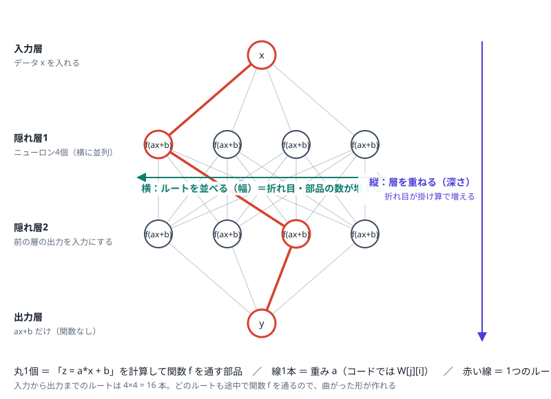

# ９．ニューラルネットワーク ― y = a*x + b を並べて、重ねて、曲線を作る

1章で扱った `y = a*x + b` は、直線しか表せない。本章では、この直線を**横に並べ、間に関数を挟み、縦に重ねる**だけで、
曲線（ここでは `y = x**2`）まで近似できることを、**式ではなくコードで**確認する。式が出てきた場合は、必ず
「コードだとこういう意味」を併記する。

## 9.1 はじめに：直線だけでは x**2 に合わない

1章の `y = a*x + b` を、`y = x**2`（x は -2〜2）に合わせるとどうなるか。

```python
def linear(x, a, b):
    return a * x + b

data = [(-2 + i * 0.1, (-2 + i * 0.1) ** 2.0) for i in range(41)]   # y = x**2 の41点
```

どんな a, b を選んでも、最良でほぼ水平な線にしかならない（a≒0, b≒1.3）。直線は曲がれないからである。
では直線を2回重ねればどうか。

```python
y = linear(linear(x, a1, b1), a2, b2)
#   = a2 * (a1 * x + b1) + b2
#   = (a2 * a1) * x + (a2 * b1 + b2)      ← 結局、傾きとずらしが1つずつの直線
```

**直線は何回重ねても直線のまま**である。曲がるためには、直線と直線の間に「曲げる部品」が必要になる。
それが**活性化関数**であり、直線＋活性化関数を1個の単位にしたものが**ニューロン**である。

## 9.2 全体の絵：ルートが並び、層が重なる



絵の読み方を、コードと対応させて示す。

| 絵の要素 | コードでの姿 |
|---|---|
| 丸1個（ニューロン） | `z = a*x + b` を計算して、関数 `f` を通す（`f(z)`） |
| 線1本 | 重み（`W[j][i]`：前の層の i 番目 → この層の j 番目にかける数） |
| 横に並んだ丸（幅） | ニューロンの数。`for j in range(H):` で回す回数 |
| 縦に重なった行（深さ） | 層の数。前の層の出力を、次の層の入力にする |
| 赤い線（1つのルート） | 入力から出力まで、1個ずつニューロンを選んでたどった経路 |

絵にはルートが 4×4 = 16 本ある。どのルートも途中で関数を通るので、曲がった形が作れる。

### 式をコードに直すと

ニューラルネットワークの説明では、次のような式がよく出てくる。ここでは式の意味を、そのままコードで示す。

```
式： y = c + Σ vᵢ · ReLU(wᵢ · x + bᵢ)       （隠れ層1層の場合）
```

```python
y = c                                        # 全体の上下位置
for i in range(H):                           # Σ（i を 0 から H-1 まで足す）の意味
    y += v[i] * max(0, w[i] * x + b[i])      # vᵢ·ReLU(wᵢ·x + bᵢ) の意味
```

`Σ` は `for` で回して `+=` で足すこと、`ReLU(z)` は `max(0, z)` のことである。

層が複数（行列を使う書き方）の場合は、次のとおりである。

```
式： 出力 = f(X @ W.T + b)          （5章でも使った形）
```

```python
for j in range(H):                          # ニューロン j ごとに
    z = b[j]
    for i in range(len(x)):                 # 入力 i について
        z += W[j][i] * x[i]                 # a*x の合計（入力が複数の場合の a*x）
    out[j] = f(z)                           # 関数を通す
# NumPy なら、上の二重ループが次の1行になる（5章）
out = f(X @ W.T + b)
```

## 9.3 部品をコードで作る

動かせるコード：[09-2ApproxX2.py](09-2ApproxX2.py)（素のPython、Colabでそのまま実行可）

### 部品A：直線（1章と同じ）

```python
def linear(x, a, b):
    return a * x + b
```

### 部品B：ReLU（曲げる部品）

```python
def relu(z):
    return max(0.0, z)      # 負なら0、正ならそのまま
```

グラフにすると、0 までは平らで、0 を超えたら傾き1で上がる**折れ線（折れ目が1個）**である。
この関数自体は学習中も一度も変わらない。

### 部品C：ニューロン1個＝直線 → ReLU

```python
def neuron(x, w, b):
    return relu(linear(x, w, b))
```

`w` と `b` を変えると、折れ線が次のように動く。

```python
neuron(x, 1, 0)     # x=0 で折れる。右上がり
neuron(x, 1, -1)    # x=1 で折れる（b を下げると折れ目が右へ）
neuron(x, -1, 0)    # x=0 で折れる。左上がり（w が負だと向きが反転）
neuron(x, 2, 0)     # x=0 で折れる。傾きが2倍
```

折れ目の位置は `-b / w` である。**ニューロン1個は、位置・向き・傾きを調整できる折れ線の部品**と考えるとよい。

### 部品D：並べて、倍率をかけて、足す

```python
def predict(net, x):
    W, B, V, C = net["W"], net["B"], net["V"], net["C"]
    y = C
    for i in range(len(W)):                    # ニューロンを H 個並べる（横）
        y += V[i] * neuron(x, W[i], B[i])      # 倍率 V をかけて足す
    return y
```

ここにも `ax + b` の形が出てくる（`V[i]` が a、`C` が b にあたる）。つまりこのネットワークは、
**直線 → 関数 → 直線**の2段構えである。

学習で変わるのは `W, B, V, C` の4つの数字だけで、`neuron` や `predict` の構造は変わらない。

### 用語の対応

| ニューラルネットワークの用語 | このコードでの呼び方 |
|---|---|
| ニューロン（ユニット） | `neuron(x, w, b)`、または出力ベクトルの1要素 |
| 重み・バイアス | `W`・`B`（5章と同じ） |
| 層（レイヤー） | 「直線を並列に並べる ＋ 関数を通す」のひとまとまり |
| 順伝播 | `predict` を計算すること（1章の①予測） |
| 逆伝播 | 出力側から入力側へ、層の数だけ連鎖律で勾配を求めること（9.7） |
| 深層学習 | 層を何段も重ねたニューラルネットワーク |

## 9.4 縦と横の構成の意味と効果

### 手で作ると、仕組みが分かる

折れ線の部品を足し合わせると曲線になることを、手で決めた重みで確認する。

```python
hand = {"W": [1, 1, 1, 1], "B": [2, 1, 0, -1], "V": [-3, 2, 2, 2], "C": 4}
for x in [-2, -1, 0, 1, 2]:
    print(x, x**2, predict(hand, x))
# → 5点とも x**2 と一致（4, 1, 0, 1, 4）
```

`B = [2, 1, 0, -1]` が折れ目の位置（x = -2, -1, 0, 1）、`V` が各部品の倍率である。x² の点を直線でつなぐと、
傾きが -3 → -1 → 1 → 3 と折れ目ごとに +2 ずつ増えるので、それを `V` で作っている。
**部品の位置（B）と倍率（V）を選べば曲線が作れる**。次節以降は、これを機械に探させる。

### 横に並べる（ルートを増やす）効果

ニューロン数 H を変えて、最終的な誤差（MSE）を比較した（10000回学習、乱数初期値を変えて3回）。

| 横：ニューロン数 H | 誤差（最小〜最大） | 様子 |
|---|---|---|
| 1 | 0.99208 | 折れ目が1個。ほぼ水平線で、1章の直線と同じ状態 |
| 2 | 0.019 〜 0.020 | 折れ目2個の粗い折れ線 |
| 4 | 0.0025 〜 0.0104 | 5点の折れ線で、放物線に近い形になる（初期値で差が出る） |
| 16 | 0.00017 〜 0.00024 | ほぼ一致 |

ニューロン1個が「折れ目1個の部品」なので、**横に増やすほど、使える部品が増え、細かい形を表現できる**。
入力が複数ある問題（5章の256ドットなど）では、各ニューロンが入力の別々の組み合わせ（別々の `W[j]`）を見るので、
隠れ層のニューロン8個は「8種類のパターン検出器」になる。

### 縦に重ねる（層を増やす）効果

横に並べると折れ目は**足し算**で増える。縦に重ねると、**掛け算**で増える場合がある。
次のコードは、ニューロン2個で作る山型を何回も重ねている。

```python
def tent(x):
    return 2 * relu(x) - 4 * relu(x - 0.5)       # ニューロン2個で山型を作る

f = lambda x: x
for k in range(1, 6):
    g = f
    f = lambda x, g=g: tent(g(x))                # 前の層の出力を、次の山型の入力にする
    print(k, "層", 2 * k, "個 →", pieces(f), "区間")
```

| 縦：層の数 | ニューロン数 | 折れ線の区間数 |
|---|---|---|
| 1 | 2 | 2 |
| 2 | 4 | 4 |
| 3 | 6 | 8 |
| 4 | 8 | 16 |
| 5 | 10 | 32 |

ニューロンは2個ずつ増えるだけなのに、区間数は倍々になる。1層だけで10個並べても、区間数は高々11である。
紙を折り重ねるように、**前の層の出力を、次の層がさらに折る**ためである。

ただし、`y = x**2` のような単純な曲線では、層を重ねても劇的には変わらない（9.7の結果を参照）。縦が効くのは、
画像や言語のように、「線 → 形 → 物体」と部品を組み合わせて作る構造を持つ問題である。

## 9.5 間に挟む関数にはどんなものがあるか

```python
import math
acts = {
    "relu":    lambda z: max(0.0, z),
    "leaky":   lambda z: z if z > 0 else 0.1 * z,
    "tanh":    math.tanh,
    "sigmoid": lambda z: 1 / (1 + math.exp(-z)),
    "linear":  lambda z: z,
}
```

z = -2, -1, 0, 1, 2 を入れたときの値は次のとおりである（実行結果）。

| 関数 | -2 | -1 | 0 | 1 | 2 | 特徴と主な用途 |
|---|---:|---:|---:|---:|---:|---|
| relu | 0.00 | 0.00 | 0.00 | 1.00 | 2.00 | 折れ線。計算が単純で、隠れ層の標準 |
| leaky | -0.20 | -0.10 | 0.00 | 1.00 | 2.00 | 負側にわずかな傾き。動かなくなるニューロンの対策 |
| tanh | -0.96 | -0.76 | 0.00 | 0.76 | 0.96 | -1〜1 に収まる滑らかなS字。滑らかな関数の近似向き |
| sigmoid | 0.12 | 0.27 | 0.50 | 0.73 | 0.88 | 0〜1 に収まる。3章の判定（確率）の出力 |
| linear | -2.00 | -1.00 | 0.00 | 1.00 | 2.00 | 何もしない。回帰の出力層 |

複数の値をまとめて確率にする **softmax** もある。

```python
e = [math.exp(z) for z in (2.0, 1.0, 0.1)]
[v / sum(e) for v in e]       # → [0.66, 0.24, 0.1]（合計が1。多クラス分類の出力層）
```

層の最後（出力層）に何を使うかは、課題で決まる。

| 課題 | 出力層の関数 |
|---|---|
| 数値を予測する（回帰。本章の x² など） | linear（関数を挟まない） |
| 2値の判定 | sigmoid |
| 多クラスの判定（5章） | softmax |

新しい関数を使うときは、**関数そのものと、その微分（学習で使う）をセットで用意する**必要がある（9.7）。

## 9.6 y = x**2 を近似していく過程

動かせるコード：[09-2ApproxX2.py](09-2ApproxX2.py)

1章の学習の流れ（予測 → 誤差 → 勾配 → 補正）と同じことを、`W, B, V, C` に対して行う。
条件を1章の設定条件表の形で示す。

| 番号 | 項目 | 設定・内容 |
|:---:|:---:|:---|
| ① | モデル | 直線 → ReLU を4個並べ、倍率をかけて足す（`predict`） |
| ② | パラメータ | `W, B, V, C`（4個ずつ＋1個＝計13個） |
| ③ | 初期値 | 折れ目を -2〜2 に散らし、`V` は小さな乱数 |
| ④ | 損失関数 | `(予測値 - 正解値)**2` の平均（1章と同じ） |
| ⑤ | 勾配 | 下記の `train` のとおり |
| ⑥ | 学習率 | `0.02` |
| ⑦ | epoch | `20000` |

### 式をコードに直すと（損失と勾配）

```
式： Loss = (1/N) Σ (予測 - 正解)²
```

```python
loss = sum((predict(net, x) - t) ** 2 for x, t in data) / len(data)
```

```
式： ∂Loss/∂y = 2·(予測 - 正解)/N       （誤差が出力にどう効くか）
```

```python
dy = 2 * (predict(net, x) - t) / N
```

1章の `weight_gradient = 2 * (prediction - target) * x` と同じ形で、パラメータごとに「そこへ至る道筋の係数」を掛けていく
（連鎖律）。コードにすると次のとおりである。

```python
for x, t in data:
    dy = 2 * (predict(net, x) - t) / N
    gC += dy                              # C は y に直接足されている
    for i in range(H):
        z = W[i] * x + B[i]
        if z > 0:                         # ReLU が働いているときだけ（平らな部分は影響なし）
            gV[i] += dy * z              # V は「ReLU の出力」倍されている
            gW[i] += dy * V[i] * x       # W は x 倍されて ReLU に入る
            gB[i] += dy * V[i]           # B はそのまま ReLU に入る
# 勾配の逆方向に動かす（1章の補正と同じ）
for i in range(H):
    W[i] -= lr * gW[i]; B[i] -= lr * gB[i]; V[i] -= lr * gV[i]
C -= lr * gC
```

### 実行結果：折れ線が x**2 に近づいていく

H=4。正解は `y(-2..2) = 4.00 1.00 0.00 1.00 4.00` である。

| epoch | 誤差(MSE) | y(-2), y(-1), y(0), y(1), y(2) | 折れ目の位置 x |
|---:|---:|---|---|
| 0 | 2.76954 | 0.56, 0.42, 0.26, 0.13, 0.14 | -1.50, -0.50, 0.50, 1.50 |
| 100 | 0.21778 | 2.86, 1.41, 0.45, 1.35, 3.13 | -1.31, -0.38, 0.27, 0.99 |
| 1000 | 0.01611 | 3.79, 1.03, 0.04, 1.12, 3.65 | -1.11, -0.63, 0.41, 0.95 |
| 5000 | 0.01197 | 3.91, 1.03, 0.07, 1.11, 3.72 | -1.30, -0.66, 0.46, 1.21 |
| 20000 | 0.01175 | 3.95, 1.04, 0.07, 1.12, 3.72 | -1.35, -0.65, 0.46, 1.25 |

見るべき点は2つある。

1. 最初は、ほぼ平らな線（予測が 0.1〜0.6 付近）である。100回で大きな形が決まり、1000回でほぼ収束する。
2. **折れ目の位置が動いている**。最初は等間隔（-1.50, -0.50, 0.50, 1.50）に置いた折れ目が、学習で位置を変えていく
   （たとえば 1.50 → 1.25、-0.50 → -0.65）。誤差が下がるように、折れ目が自動で配置を探している。
   ニューロン4個では、5000回以降はほとんど改善しない。これ以上は**部品の数が足りない**ためと考えられる（9.4の横の効果）。

### ブラウザで動きを見る

[09-4ReluFit.html](https://tasamu61.github.io/MyAiStudyPre/9.NeuralNetwork/09-4ReluFit.html)
（ニューロン数・学習率を変えながら、折れ線が変形する様子、折れ目の移動、各ニューロンの寄与、式と値を見られる）

## 9.7 層・幅・関数を変えて試す（NumPy版）

動かせるコード：[09-3DeepX2.py](09-3DeepX2.py)

`make_net([1, 8, 8, 1])` のように、層の数と幅を配列で指定でき、関数名も差し替えられる。

```python
W, B = make_net([1, 8, 8, 1])        # 入力1 → 8 → 8 → 出力1（隠れ層が2層）
train(W, B, X, T, "tanh")            # "relu" / "leaky" / "tanh" / "sigmoid"
```

学習の中心は、出力側から入力側へ誤差を伝える次の部分である（逆伝播）。

```python
delta = 2 * (出力 - 正解) / N                      # 出力での誤差の効き
for l in reversed(range(len(W))):                # 出力側の層から順に
    gW, gB = delta.T @ as_[l], delta.sum(axis=0) # この層の W, B の勾配
    if l > 0:
        delta = (delta @ W[l]) * d(zs[l - 1])    # 1つ前の層へ誤差を渡す（d は関数の微分）
    W[l] -= lr * gW
    B[l] -= lr * gB
```

9.6 の手書きの勾配計算を、層の数だけ繰り返しているだけである。`d(...)`（関数の微分）が出てくるので、
**関数を替えるときは、関数と微分をセットで替える**。

| 構成 | 誤差（最小〜最大、3回） |
|---|---|
| `[1, 16, 1]` ReLU（横に16個） | 0.00048 〜 0.00182 |
| `[1, 8, 8, 1]` ReLU（8×2層） | 0.00050 〜 0.00083 |
| `[1, 8, 8, 1]` tanh | 0.00010 〜 0.00023 |
| `[1, 8, 1]` sigmoid | 0.00103 〜 0.00151 |

読み取れることは次のとおりである。

- ReLU では、横16個と、8×2層の誤差は同程度である。`y = x**2` では、縦の効果はそれほど大きくない。
- tanh が一桁小さい。`x**2` は滑らかな曲線なので、折れ線の ReLU より、滑らかな関数の方が合う。
  **課題の性質に合わせて関数を選ぶ**例である。

## 9.8 限界：学習した範囲の外は当たらない

```python
# tanh、[1, 8, 8, 1] で学習したあと
x=1.5 → 2.243    # 正解 2.25（学習範囲の内側は合う）
x=5   → 6.012    # 正解 25  （学習範囲 -2〜2 の外側は大きく外れる）
```

ニューラルネットワークは、学習データの範囲内の**補間**は得意だが、範囲外の**外挿**は苦手である。
範囲の外では、折れ線は最後の傾きのまま直線的に伸びるだけだからである。ReLU の場合は特にそうなる。

## 9.9 これまでの章の総括

| 章 | 内容 | ニューラルネットワークでの位置づけ |
|---|---|---|
| [1.機械学習の基本](../1.MachineLearningBasic) | `y = ax + b`を例にした、予測→Loss→微分→補正という学習の基本サイクル | NNの学習も全く同じサイクルを、数百万パラメータに拡張しただけである |
| [2.学習プロセスの構成](../2.Configuration) | モデルの形、損失関数、初期値、学習率、局所解といった、学習に関わる要素の整理 | NNではこれらの悩みがより深刻になる（9.10.1で見る初期値の問題はその一例） |
| [3.16×16ドット](../3.16x16Dots) | 256入力+バイアスの単純なモデルで「1」を判定。シグモイドと連鎖律。PyTorchの`nn.Linear`にも接続 | これ自体が「1層のニューラルネットワーク（パーセプトロン）」である |
| [4.配列・Python・NumPy](../4.ArrayPythonNumPy) | 行列演算7パターン、Pythonの演算子オーバーロード、numpyの実装方針 | PyTorch/TensorFlowが内部で使っている計算の文法そのもの |
| [5.ベクトル・行列](../5.VectorMatrix) | バッチ処理・多クラスの線形層（`X @ W.T + b`） | **全結合層（Linear/Dense層）そのもの**。これを複数重ねたものがNNである |
| [6.文字、Token処理](../6.Text) | 文字・トークン単位でのデータ化 | 自然言語処理モデル・LLMの入力前処理（埋め込み層の手前） |
| [7.次元削減](../7.DimensionReduction) | PCAによる次元削減 | 中間層が学習する「特徴表現」や、オートエンコーダの考え方に直結 |
| [8.次元削減２](../8.DimensionReduction256) | 256次元データの次元削減と量子化 | 実務でのモデル圧縮・高速化（量子化は実際のLLMデプロイで使われる技術そのもの） |


## 9.10 サンプルプログラム：2層ニューラルネットを作ってみる

- [09-1TwoLayerNN.py](09-1TwoLayerNN.py) / [09-1TwoLayerNN.ipynb](https://colab.research.google.com/github/tasamu61/MyAiStudyPre/blob/main/9.NeuralNetwork/09-1TwoLayerNN.ipynb)

5章と全く同じ15件の学習データ・6件の評価データ（学習には使っていない、"near"=近い位置、
"far"=遠い位置の図形）を使い、256入力→**隠れ層(8ユニット、ReLU)**→3クラス、という
2層のモデルを組んで比較する。

### 9.10.1 初期値のワナ：隠れ層をゼロ初期化すると何が起きるか

2章で「初期値」が学習に影響する要素の1つとして触れたが、隠れ層を持つモデルでは
これが**致命的な問題**になりうる。1層目の重みを全部ゼロで初期化すると、どの隠れユニットも
「同じ入力×同じ重み(0)」という全く同じ計算をすることになり、勾配も全ユニットで完全に
同じ値になる。結果、**何回更新しても、H個の隠れユニットが最後まで全部同じ値のまま**に
なってしまう（「対称性が壊れない」問題）。これを避けるため、隠れ層の重みは通常、
小さな乱数で初期化する。

### 実行結果

| | 学習データ(15件) | 評価データ(6件) |
|---|---|---|
| A) 1層のみ（5章と同じ） | 15/15 | 3/6（near全部OK、far全部NG） |
| B) 2層、隠れ層8、**乱数初期化** | 15/15 | 4/6（near全部OK、farのうち1件改善） |
| C) 2層、隠れ層8、**ゼロ初期化** | 5/15 | 2/6（対称性が壊れず、学習データすら解けない） |

隠れ層を1つ足すだけで、評価データの正解数が3/6→4/6に改善した。ただし「far」（学習データ
から離れた位置の図形）のうち2件はまだ解けておらず、**全結合層を重ねるだけでは「位置が
ずれても同じ形として認識する」という能力は十分には得られない**ことも分かる。

## 9.11 この先：全結合層の限界と、次に学ぶべきもの

9.10の結果が示す通り、今回のような全結合層（Dense/Linear層）をいくら重ねても、「図形が
少し位置をずらしただけで、別の特徴として扱われてしまう」という弱さは残る。これは3章・
5章から一貫して指摘してきた、この種のモデルの構造的な限界である。

これを解決する代表的な仕組みが、本シリーズではまだ扱っていない以下のようなものである。

- **CNN（畳み込みニューラルネットワーク）**：画像のどこにパターンがあっても同じように
  検出できる仕組みを持ち、3章・5章・9章で繰り返し出てきた「位置ずれに弱い」問題を
  直接解決する
- **Transformer**：6章で扱った文字・トークン処理を、現在のLLMが使っている形（Attention
  機構）に発展させたもの

8章までの内容は、まさにこれらを学ぶための土台（行列演算、トークン化、次元削減・量子化）
になっている。本シリーズの範囲はここまでとなるが、次のステップとして、これらのキーワードで
学習を進めることを勧める。

[← トップページへ](../)
